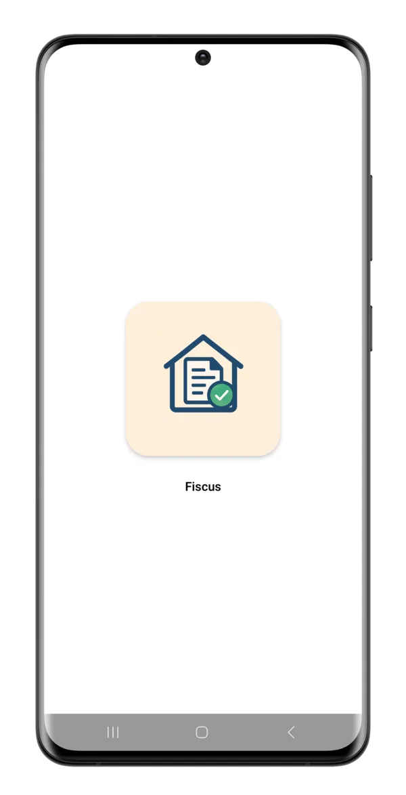
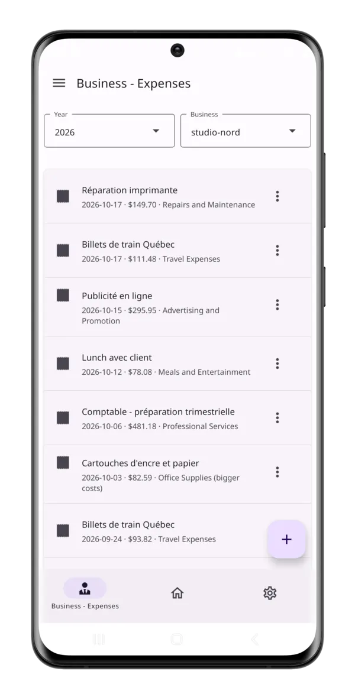
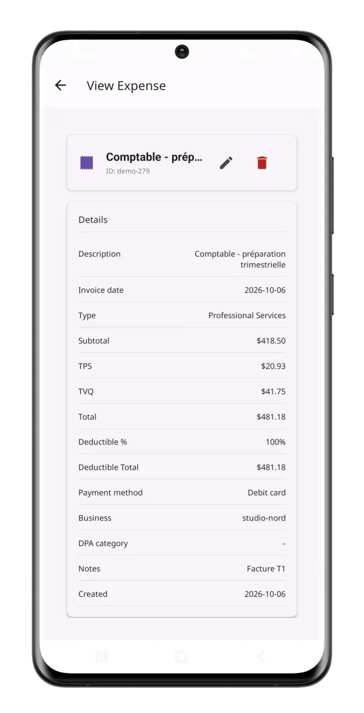
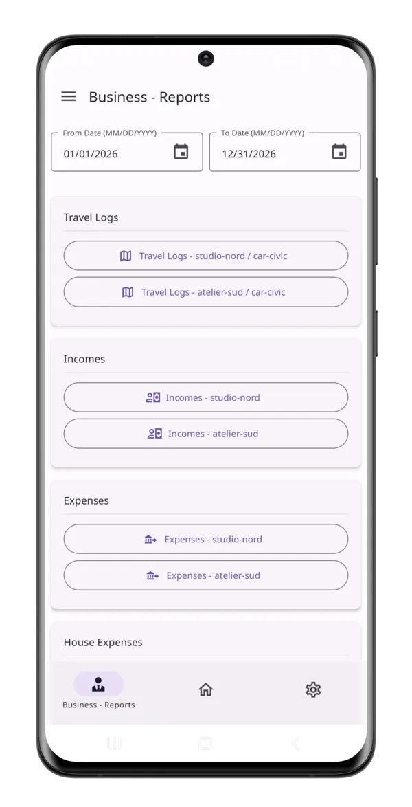

# Fiscus

<p align="center">
  
  
  
  
</p>

Fiscus is a personal accounting app for a small Canadian business (CRA T2125 style categories). It has two parts:

- a **serverless backend** on AWS: Python Lambda functions behind an API Gateway REST API (API-key protected), storing records in DynamoDB and files in S3, defined as code with AWS SAM (`template.yaml` and `openapi.yaml`, generated from `api/`);
- a **mobile app** (Expo / React Native) in `mobile-app/`.

It tracks incomes, expenses, car expenses, house expenses, travel logs and miscellaneous files, and can produce Excel reports.

## Table of contents

- [Purpose](#purpose)
- [Origin](#origin)
- [Why it is built this way](#why-it-is-built-this-way)
- [Prerequisites](#prerequisites)
- [Deploy](#deploy)
- [Update](#update)
- [API keys](#api-keys)
- [Mobile app](#mobile-app)
- [Removing a stack](#removing-a-stack)
- [Recommended account hygiene](#recommended-account-hygiene)
- [Development](#development)
  - [Adding or changing an endpoint](#adding-or-changing-an-endpoint)
  - [Code layout](#code-layout)
  - [Data model](#data-model)
  - [Error convention](#error-convention)
- [License](#license)

## Purpose

I built Fiscus to push AWS Lambda as far as I could, and to automate as much of its upkeep as possible. The whole backend runs on Lambda, API Gateway, DynamoDB and S3. Nothing is configured by hand in the console: the API and the infrastructure are generated from a single `routes.yaml` (OpenAPI, functions, permissions and IAM policies), so adding an endpoint means editing one file and running one script. Every commit is checked by a git hook (lint, template validation, tests with mocked AWS), and a deploy is `sam build && sam deploy`.

The question behind it was: how little manual work does it take to build, change and ship a complete serverless backend, and how far can the setup carry before it starts to creak? It's a personal tool with one user, so it isn't built to scale or for anyone else to run. The code is public so it can be read.

## Origin

Fiscus started as a playground to mess with AWS, Lambda functions, API Gateway, DynamoDB and Expo for a mobile app. It was first built during a three-day personal hackathon, and it became a full project from there.

It was originally named Abode, a home-automation assistant I created to do a bunch of things around my house using AWS. Later I extracted the accounting code from it into Fiscus, so it could be open source.

## Why it is built this way

Fiscus is my personal tool: I wrote it, I am its only user, and I use it to keep my small freelance books with as little ceremony as possible. It is built as an **MVP (minimum viable product)**: the smallest thing that does the job, shipped quickly and improved from real use. The guiding idea was **fast iterations without overcomplicating things**: something quick to build, cheap to run, easy to maintain alone, and fully self-served on one AWS account. A few consequences, deliberately accepted:

| Choice                                                                     | Why                                                                                                                  | Trade-off                                                                                           |
| -------------------------------------------------------------------------- | -------------------------------------------------------------------------------------------------------------------- | --------------------------------------------------------------------------------------------------- |
| Serverless (Lambda, DynamoDB, S3, API Gateway) defined in one SAM template | No server to patch, pay-per-request, essentially free at personal volume; the whole backend deploys with one command | More moving parts than a single small server; local testing relies on mocks (moto)                  |
| One small Lambda per action (`CreateExpense`, `ReadIncomes`, ...)          | Each handler is ~20 lines and easy to read on its own; shared code lives in one layer (`fiscus`)                     | Many functions and IAM policies to keep in sync (tests in `tests/` guard this)                      |
| An API key plus a user id typed in the app's settings                      | One owner, one or two devices: no sign-up, login or user database needed                                             | The key grants access to everything in the stack; the user id is a label, not a permission boundary |
| Business, car and house ids entered by hand in the settings                | Creating those ids is rare, so there is no screen or table for them                                                  | Ids are free text; a typo creates a new "business"                                                  |
| Lists read with filtered table scans                                       | Simple and correct for a few thousand records per year                                                               | Gets slower and costlier as data grows (indexes already exist for a switch to queries)              |
| Expo app for iOS, Android and the web from one code base                   | One app, built and updated by one person                                                                             | Native builds go through EAS (manual, uses build credits)                                           |
| Checks run in a git pre-commit hook, not CI                                | Instant feedback, nothing to pay for or maintain on GitHub                                                           | Relies on the hook being installed (`pre-commit install`)                                           |

The code still aims to be clean where it matters: typed models, one API client, shared UI building blocks, input validation with clear 400/404 errors, atomic writes, and tests for the logic (`pytest` for the backend, `jest` for the app). Some choices are kept simple on purpose (for example attachments stored as JSON text and the `{statusCode, message, data}` response body).

It can grow up if it ever needs to: [docs/ROADMAP.md](docs/ROADMAP.md) lists the improvements that would make sense next and how they would be done.

> **Disclaimer.** Fiscus is not tax, accounting or financial advice. It is provided as is, without warranty of any kind, and you use it at your own risk. Check every figure with a qualified professional before filing anything. The software is licensed for noncommercial use only; see [LICENSE](LICENSE) (PolyForm Noncommercial 1.0.0).

## Prerequisites

- An AWS account.
- [AWS CLI v2](https://docs.aws.amazon.com/cli/latest/userguide/getting-started-install.html) and [AWS SAM CLI](https://docs.aws.amazon.com/serverless-application-model/latest/developerguide/install-sam-cli.html).
- Python 3.14 (the Lambdas run on `python3.14`; `sam build` uses your local Python).
- An AWS profile allowed to deploy CloudFormation stacks and create IAM roles, Lambda functions, API Gateway APIs, DynamoDB tables and S3 buckets.

## Deploy

```bash
sam build
sam deploy --guided --profile <your-profile>
```

`--guided` asks a few questions and saves the answers in `samconfig.toml` (git-ignored) so later deploys need no prompts:

| Prompt                               | Meaning                                                                                                                                                             |
| ------------------------------------ | ------------------------------------------------------------------------------------------------------------------------------------------------------------------- |
| Stack Name                           | CloudFormation stack name, e.g. `fiscus`.                                                                                                                           |
| AWS Region                           | Where everything is created. The template hard-codes no region or account.                                                                                          |
| Parameter `TableNamePrefix`          | Prefix for the ten DynamoDB table names (`Incomes`, `Expenses`, ...). Leave empty, or use e.g. `test-` for a second, separate stack in the same account and region. |
| Parameter `BucketName`               | Name of the files bucket. Leave empty to get `fiscus-files-<account id>-<region>`.                                                                                  |
| Confirm changes before deploy        | Answer `y` to review the change set before it runs.                                                                                                                 |
| Allow SAM CLI IAM role creation      | Answer `y`; the stack creates the Lambda execution roles (it needs `CAPABILITY_IAM`).                                                                               |
| Save arguments to configuration file | Answer `y`, so `sam deploy` and `scripts/keys.py` can reuse the stack name, region and profile.                                                                     |

The tables and the bucket have `DeletionPolicy: Retain` (tables also have deletion protection): deleting the stack never deletes your data.

When the deploy finishes, the stack outputs `ApiUrl`, `StarterApiKeyId`, `UsagePlanId` and `BucketName`. Read the value of the starter API key:

```bash
aws apigateway get-api-key --api-key <StarterApiKeyId> --include-value --query value --output text
```

Every request must send this value in the `x-api-key` header. The usage plan's quota (5000 requests per day) and throttle (25 requests per second, burst 100) apply to each API key separately. The stage-level throttle (25 requests per second, burst 25) caps the whole API, all keys together.

## Update

```bash
sam build
sam deploy
```

This reuses `samconfig.toml`. Read the change set: for a stack that already holds data, there should be no Modify or Remove on any table or on the bucket. Keep `TableNamePrefix` and `BucketName` the same on every deploy: a new value makes CloudFormation create new, empty tables or a new bucket (the old ones are kept, but the app stops seeing their data).

## API keys

Extra keys (one per person or device) are created outside the template, so `sam deploy` never touches them. `scripts/keys.py` reads the stack name, profile and region from `samconfig.toml`; override them with `--stack`, `--profile` and `--region` (placed before the command).

```bash
python scripts/keys.py add <name>      # creates a key on the usage plan, prints its value
python scripts/keys.py list            # name, id, creation date, enabled/disabled
python scripts/keys.py remove <name>   # detaches and deletes the key (refuses the template's starter key)
```

The script needs `boto3` (`pip install -r requirements-dev.txt`). The same with the AWS CLI:

```bash
aws apigateway create-api-key --name <name> --enabled
aws apigateway create-usage-plan-key --usage-plan-id <UsagePlanId> --key-id <key id> --key-type API_KEY
aws apigateway get-usage-plan-keys --usage-plan-id <UsagePlanId>
aws apigateway delete-usage-plan-key --usage-plan-id <UsagePlanId> --key-id <key id>
aws apigateway delete-api-key --api-key <key id>
```

To check a deployment, run the smoke test (standard library only). It calls every `GET` route except the file download; add `--write` to also create, update and delete a test record on `/misc-files` and `/travel-logs`:

```bash
python scripts/smoke_test.py --url <ApiUrl> --key <api key> [--write]
```

## Mobile app

The app lives in `mobile-app/` and covers every record type: list, view, create, edit and delete (deleted expenses and incomes go to the archive tables), plus attachments and Excel reports. On iOS and Android, enter the stack's `ApiUrl` output and an API key in the app's Settings screen; they are stored on the device, so a new URL needs no new build. To have the URL pre-filled, set `DEFAULT_API_URL` in `mobile-app/lib/config.ts`. For the web build, copy `mobile-app/.env.sample` to `.env` and fill it in (`EXPO_PUBLIC_API_URL` is the `ApiUrl` output); Expo bakes `EXPO_PUBLIC_*` values into the build. See [mobile-app/README.md](mobile-app/README.md) for the scripts (`yarn typecheck`, `yarn lint`, `yarn test`) and the code layout.

## Removing a stack

`sam delete` (or deleting the stack in CloudFormation) removes the functions, API, usage plan and starter key, but **leaves the ten DynamoDB tables and the files bucket behind**: they have `DeletionPolicy: Retain`, and the tables also have deletion protection. This is deliberate, so a stack deletion cannot destroy your data. To remove a throwaway stack's data as well:

```bash
aws dynamodb update-table --table-name <table> --no-deletion-protection-enabled
aws dynamodb delete-table --table-name <table>      # repeat for each of the ten tables
aws s3 rm s3://<bucket> --recursive                 # empty the bucket (also remove versions if versioning was ever on)
aws s3api delete-bucket --bucket <bucket>
```

> **Warning:** do this only for a test stack (for example one deployed with `TableNamePrefix=test-`). Never run it against a stack holding real records: the deletes are permanent and cannot be undone.

## Recommended account hygiene

- Deploy with a dedicated IAM user (or group) that has only the permissions needed to deploy this stack, not with root credentials or an administrator user. Use a separate read-only profile for day-to-day inspection.
- Create an AWS monthly budget with an alert (AWS Budgets) so an unexpected bill does not go unnoticed.
- Remove an API key when its device is lost (see [API keys](#api-keys)).

## Development

Besides the deploy prerequisites, the git hook needs [Node.js](https://nodejs.org/) 20.18.1 or newer, [Yarn 1](https://classic.yarnpkg.com/) (`npm install --global yarn`, or `corepack enable`) and the app's packages installed: it runs the mobile checks whenever a commit touches `mobile-app/`.

```bash
pip install -r requirements-dev.txt
(cd mobile-app && yarn install)   # needed by the hook's mobile checks
pre-commit install          # git hook: ruff, cfn-lint, pytest (and the mobile checks)
ruff check . && ruff format .
pytest
sam validate --lint
```

`pytest` runs the template, OpenAPI, generator, handler and script tests (AWS calls are mocked with moto). The pre-commit hook runs the same checks on every commit; there is no CI on GitHub. If the `pre-commit` command is not on your PATH, use `python -m pre_commit`.

### Adding or changing an endpoint

`openapi.yaml` and the function and permission resources of `template.yaml` are generated; do not edit them by hand. Edit `api/routes.yaml` (routes, functions and their IAM policies, request models; the file header explains the format), or `api/template.base.yaml` for everything else in the template (tables, bucket, layers, API settings, outputs). Then run:

```bash
python scripts/gen_api.py           # rewrites openapi.yaml and template.yaml
python scripts/gen_api.py --check   # fails if they are out of date
```

### Code layout

- `api/`: the sources of `openapi.yaml` and `template.yaml` (see above).
- `lambda/<area>/<Handler>.py`: one file per Lambda function. A handler validates its input, reads or writes DynamoDB/S3 and returns `ok(...)`. Each handler reads its own table names from `os.environ["TABLE_..."]`; the template tests derive every function's IAM policies from those reads, so keep them in the handler file.
- `layers/common/python/fiscus/`: shared code, deployed as `CommonLayer` and attached to every function. `api` (responses and error handling), `validation` (required fields, numbers), `dynamo` (paginated scans, 404 lookups, atomic date moves, archive + delete), `dates`, `money`, and `xlsx` (report sheets; report functions only).
- `layers/openpyxl/`: the `openpyxl` dependency of the report functions.

### Data model

DynamoDB only declares keys, so there is no single schema file. The pieces live in three places:

- **Tables** (names, partition/sort keys, indexes): `api/template.base.yaml`. Incomes, expenses, car expenses, house expenses and travel logs use `id` + a date as key, with a `userId` index where the lists need it; the archive tables hold deleted records.
- **Request bodies** (the fields each create/update call accepts): `models` in `api/routes.yaml`, which also generates the OpenAPI schemas.
- **Stored records**: built field by field in each handler (`lambda/<area>/Create*.py`), with `fiscus.validation` and `fiscus.money` checking the values. The app's matching TypeScript types are in `mobile-app/lib/types/`.

Keeping these in sync by hand is a known limit of the design; the tests in `tests/` check the template and the OpenAPI document, not the record shape.

### Error convention

API Gateway always answers HTTP 200; the outcome is in the body as `{"statusCode", "message", "data"}`. Handlers wrapped in `@api_handler` return **400** for invalid or missing input (the message names the fields), **404** when the item does not exist, and **500** with the message `Internal server error` for anything unexpected (the details go to CloudWatch Logs, never to the client).

## License

[PolyForm Noncommercial License 1.0.0](LICENSE). Copyright 2024-2026 Marc-André Jean.
